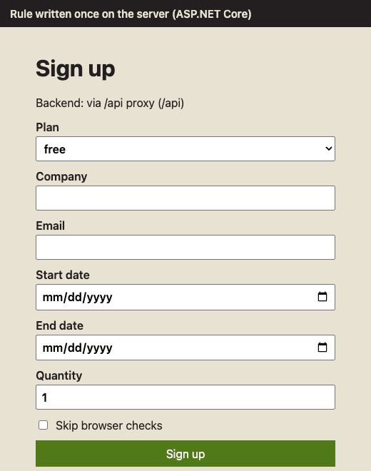

<p align="center">
  <picture>
    <source media="(prefers-color-scheme: dark)" srcset="assets/brand/banner/readme-banner-dark.png">
    
  </picture>
</p>

# validonce

Write cross-field validation rules once, on the server, and enforce the same rules in the browser.

Field rules such as types, lengths and patterns already travel from a backend's OpenAPI document to the frontend. Rules that involve more than one field do not: "company is required when the plan is Pro", "the end date must be on or after the start date". Teams write those twice, once in the backend and once in the form, and the two copies drift. validonce exports the rules from your backend (ASP.NET Core, FastAPI, Fastify, NestJS, Go, Spring Boot, or a Kubernetes CRD's CEL) as data in your OpenAPI document, and a small runtime applies them in the browser, so React, Angular, Vue and plain HTML forms check the same rules and show each error on the right field.

**[▶ Try it in the playground](https://playground.metatoy.com)**: pick a backend and a frontend and watch the same rules run in both. No install.

**[Read the docs at validonce.metatoy.com](https://validonce.metatoy.com)**: a guide for every stack, live examples of each rule kind, search, and docs for each release.

<p align="center"><a href="https://playground.metatoy.com"></a></p>

[](https://codespaces.new/metatoy/validonce) [](https://scorecard.dev/viewer/?uri=github.com/metatoy/validonce)

Try it without installing anything: the button opens a ready-to-run demo (ASP.NET backend and React form, with the shared rules enforced in the browser and on the server). It runs in a GitHub Codespace and uses your own free Codespaces hours.

<p align="center"></p>

> **Status: v0.5.** Adds Kubernetes custom resources (CEL rules translated to `x-validonce`) and plugins for the kubb, Hey API and orval client generators. v0.4 added Go, Spring Boot (Java and Kotlin), Fastify, NestJS, Vue and plain HTML forms; v0.3 added `validonce wrap` and the Codespaces demo. The full history is in the [changelog](CHANGELOG.md).

## How it works

<p align="center"><picture><source media="(prefers-color-scheme: dark)" srcset="assets/diagram/how-it-works-dark.png"></picture></p>

The server always enforces the rules. The browser runs them first to give fast feedback. If the browser is skipped or out of date, the server's 422 response uses the same issue shape, and the client maps it back onto the form fields.

## Features

- Five rule kinds: `required_when`, `compare`, `at_least_one_of`, `exactly_one_of`, `all_or_none`. See [the rule format](docs/rule-format-v1.md).
- C# (primary): FluentValidation validators, ASP.NET Core minimal APIs and MVC, OpenAPI export.
- Python: Pydantic models and FastAPI.
- TypeScript servers: Fastify (TypeBox) and NestJS, with `validonce/rules` builders.
- Go: struct rules with Huma and go-playground/validator.
- Java and Kotlin: Spring Boot with Bean Validation and springdoc (`com.metatoy:validonce-spring`).
- TypeScript client: Zod 4, react-hook-form helpers, Angular Signal Forms and Reactive Forms, Vue with VeeValidate, plain HTML and web components (`validonce/dom`), server-error mapping.
- One shared conformance suite (125 cases) that every evaluator (C#, Python, TypeScript, Go, Java) passes.
- Kubernetes: the CEL rules of custom resources (`x-kubernetes-validations`) translate to `x-validonce`, checked against the API server's own validation.
- Generator plugins: the Zod schemas that kubb, Hey API and orval generate carry the cross-field rules.
- AI-assisted migration: an MCP server (`validonce-mcp`) and a Claude Code plugin find your existing cross-field checks, rewrite them as validonce rules, and check that nothing changed on generated inputs with a differential test.
- Regex portability linter for `pattern` rules.

## Supported stacks

| Side | Stack | Package | Guide |
|---|---|---|---|
| Server | ASP.NET Core + FluentValidation | `Validonce.AspNetCore` (NuGet) | [ASP.NET Core](docs/getting-started-aspnet.md) |
| Server | FastAPI + Pydantic | `validonce` (PyPI) | [FastAPI](docs/getting-started-fastapi.md) |
| Server | Fastify | `validonce/fastify` (npm) | [Fastify](docs/getting-started-fastify.md) |
| Server | NestJS | `validonce/nestjs` (npm) | [NestJS](docs/getting-started-nestjs.md) |
| Server | Go + Huma | `github.com/metatoy/validonce/go` | [Go](docs/getting-started-go.md) |
| Server | Spring Boot (Java, Kotlin) | `com.metatoy:validonce-spring` (Maven Central) | [Spring Boot](docs/getting-started-spring.md) |
| Client | React + react-hook-form | `validonce/zod`, `validonce/react-hook-form` | [React](docs/client-react.md) |
| Client | Angular (Signal or Reactive Forms) | `validonce/zod`, `validonce/angular` | [Angular](docs/client-angular.md) |
| Client | Vue + VeeValidate | `validonce/vue` | [Vue](docs/client-vue.md) |
| Client | Plain HTML, web components | `validonce/dom` | [HTML and web components](docs/client-dom.md) |
| Client codegen | kubb, Hey API, orval (generated Zod schemas get the rules) | `validonce/kubb`, `validonce/hey-api`, `validonce/orval` | [Generated clients](docs/client-codegen.md) |
| Rules from | Kubernetes CRDs (CEL `x-kubernetes-validations`) | `validonce/kubernetes`, `validonce k8s` | [Kubernetes](docs/kubernetes.md) |
| AI tooling | Any MCP client; Claude Code (plugin: skill + server) | `validonce-mcp` (npm); `/plugin install validonce@validonce` | [Migrate with an agent](docs/agentic-migration.md) |

## Migrate an existing project with an agent

Already have cross-field checks written by hand? A coding agent can move them to validonce and check that nothing changed on generated inputs. It reads checks in FluentValidation, Pydantic, Zod, yup, Angular, go-playground/validator, Jakarta Bean Validation, class-validator, Joi and VeeValidate. Kubernetes CRDs with CEL rules (`x-kubernetes-validations`) are translated, not rewritten.

```text
/plugin marketplace add metatoy/validonce      # Claude Code: the skill and the MCP server together
/plugin install validonce@validonce

claude mcp add --transport stdio validonce -- npx -y validonce-mcp   # or just the MCP server, in any MCP client
```

The agent finds each check, rewrites it as a validonce rule, and runs a **differential test**: your old validator and validonce on thousands of generated edge-case inputs must accept and reject exactly the same. Every run is graded by code, not by a model. The 49 graded runs covered FluentValidation, Pydantic, Zod, yup and Angular (our own examples) and three public apps (.NET/FluentValidation, FastAPI/Pydantic, React/Zod). In the runs that passed, the migrated validator and the original agreed on every generated input. Those inputs use well-formed dates and the declared field types. Outside them, some yup, Angular and Zod migrations accept values the original rejected, such as malformed dates in the wrong order, so enforce date formats at runtime. The other sources (go-playground, Jakarta, class-validator, Joi, VeeValidate, Kubernetes CRDs) were graded later with Claude Code on our examples, on date cases whose proof includes malformed dates, and on one public Vue app; the results page has the numbers and the same caveat about dates. The Go, Java, TypeScript, Vue and plain HTML code targets, `translate_kubernetes` and `suggest_client_wiring` need `validonce-mcp` 0.2.0 or later. Details and results: [docs/agentic-migration.md](docs/agentic-migration.md).

## Install

```sh
dotnet add package Validonce.AspNetCore   # ASP.NET Core (brings Validonce.FluentValidation and Validonce)
pip install validonce                     # FastAPI / Pydantic (Python 3.10+, pydantic>=2.9)
go get github.com/metatoy/validonce/go    # Go / Huma (Go 1.26+)
pnpm add validonce zod                    # browser and TypeScript servers (npm install works too)
```

Maven (Gradle Kotlin DSL): `implementation("com.metatoy:validonce-spring:0.5.0")`.

## Quick start

### ASP.NET Core

```csharp
using Validonce;
using Validonce.AspNetCore;
using Validonce.FluentValidation;

var builder = WebApplication.CreateBuilder(args);
builder.Services.AddValidonce();                                     // registers every ValidonceValidator<T>
builder.Services.AddOpenApi(o => o.AddValidonceSchemaTransformer()); // adds x-validonce to schemas
var app = builder.Build();
app.MapOpenApi();
app.MapPost("/signups", (Signup s) => Results.Ok()).WithValidonce(); // 422 on a broken rule
app.Run();

public sealed record Signup(string? Plan, string? Company, DateOnly? Start, DateOnly? End);

public sealed class SignupValidator : ValidonceValidator<Signup>
{
    public SignupValidator()
    {
        RequiredWhen(x => x.Company, If.Eq(x => x.Plan, "pro")).WithMessageKey("rules.company_required");
        Compare(x => x.End, CompareOp.Ge, x => x.Start).WithMessageKey("rules.end_after_start");
    }
}
```

More: [Getting started with ASP.NET Core](docs/getting-started-aspnet.md).

### FastAPI

```python
from datetime import date
from typing import Literal

from fastapi import FastAPI
from validonce import F, ValidonceModel, when


class Signup(ValidonceModel):
    plan: Literal["free", "pro"]
    company: str | None = None
    start: date
    end: date | None = None

    __rules__ = [
        when(F.plan == "pro").require(F.company, key="rules.company_required"),
        F.end.ge(F.start, key="rules.end_after_start"),
    ]


app = FastAPI(separate_input_output_schemas=False)


@app.post("/signups")
def create_signup(body: Signup): ...
```

More: [Getting started with FastAPI](docs/getting-started-fastapi.md).

### Browser

Read the rules from the OpenAPI document and attach them to a Zod schema (shared by both frameworks):

```ts
import { rulesFromOpenApi } from "validonce/openapi";
import { withRules } from "validonce/zod";
import { z } from "zod";

const doc = await (await fetch("/openapi.json")).json();
const rules = rulesFromOpenApi(doc, "Signup")!;
const schema = withRules(
  z.object({ plan: z.string(), company: z.string().nullable(), start: z.string(), end: z.string().nullable() }),
  rules,
  { messages: { "rules.company_required": "Company is required on the Pro plan" } },
);
```

React with react-hook-form:

```ts
import { zodResolver } from "@hookform/resolvers/zod";
import { useForm } from "react-hook-form";

const form = useForm({ resolver: zodResolver(schema) });
// form.formState.errors.company?.message
```

Angular Signal Forms:

```ts
import { form, validateStandardSchema } from "@angular/forms/signals";

const f = form(model, (path) => validateStandardSchema(path, schema));
```

More: [React guide](docs/client-react.md), [Angular guide](docs/client-angular.md), [Vue guide](docs/client-vue.md).

## Docs

The docs are published at **[validonce.metatoy.com](https://validonce.metatoy.com)**, with search, a quickstart for every stack, live rule examples, and a frozen copy for each release. The same pages are in [docs/](docs/README.md) here.

**Server**
- [Getting started: ASP.NET Core](docs/getting-started-aspnet.md)
- [Getting started: FastAPI](docs/getting-started-fastapi.md)
- [Getting started: Fastify](docs/getting-started-fastify.md)
- [Getting started: NestJS](docs/getting-started-nestjs.md)
- [Getting started: Go](docs/getting-started-go.md)
- [Getting started: Spring Boot](docs/getting-started-spring.md)
- [Kubernetes custom resources](docs/kubernetes.md)

**Client**
- [React](docs/client-react.md)
- [Angular](docs/client-angular.md)
- [Vue](docs/client-vue.md)
- [Plain HTML and web components](docs/client-dom.md)
- [Generated clients: kubb, Hey API, orval](docs/client-codegen.md)
- [Loading rules at runtime](docs/live-rules.md)

**AI tooling**
- [Migrating an existing project with an agent](docs/agentic-migration.md)
- [MCP server](mcp/README.md)
- [Skill: validonce-migrate](skills/validonce-migrate/SKILL.md)
- [AGENTS.md](AGENTS.md) and [llms.txt](llms.txt)

**Reference**
- [How it works](docs/how-it-works.md)
- [Rule format v1](docs/rule-format-v1.md)
- [How validonce compares](docs/comparison.md)
- [Regex findings](docs/regex-findings.md)
- Packages: [TypeScript](js/README.md), [Python](python/README.md), [.NET](dotnet/README.md), [Go](go/README.md), [Java and Kotlin](java/README.md)
- [Changelog](CHANGELOG.md)
- [Security policy](SECURITY.md)

## Regex portability linter

A `pattern` rule written on the server runs in more than one regex engine: JavaScript in the browser (through Zod), and .NET, Python `re` or Rust (Pydantic's default engine) on the server. The engines disagree more often than you would expect. `^\w+$` rejects `Café` in JavaScript and accepts it in the other three, and a lookbehind is a hard error in Pydantic.

The linter reports these differences, with a portable rewrite where one exists:

```sh
dotnet tool install -g Validonce.Cli
validonce lint-regex openapi.json            # every pattern in an OpenAPI or JSON Schema document
validonce lint-regex --pattern '^\w+$'       # a single pattern
```

It knows 25 findings across five engines (`js`, `js-u`, `python-re`, `rust-regex`, `dotnet`). Each one is backed by test cases that run on the real engines in CI, so the table cannot drift from what the engines actually do. See [docs/regex-findings.md](docs/regex-findings.md).

The tool reads an OpenAPI file, so it works for any backend language. The same checks are available as a library through the `Validonce` NuGet package (`Validonce.Patterns.PatternLinter`). The `validonce` Python package ships the same linter (`validonce lint-regex`, `validonce.regex.lint`).

## Layout

| Path | What |
|---|---|
| `docs/` | Guides, the rule format and the regex findings table (index: [docs/README.md](docs/README.md)) |
| `conformance/` | Shared test cases every implementation must pass |
| `dotnet/` | C#: rule types, evaluator, FluentValidation and ASP.NET Core integration |
| `js/` | TypeScript: evaluator, Zod integration, form helpers, Fastify and NestJS builders, Kubernetes translation, generator plugins |
| `java/` | Java and Kotlin: rule model, evaluator, builders and the Spring Boot integration (Gradle) |
| `go/` | Go: rule builders, evaluator, and the Huma and go-playground/validator adapters |
| `python/` | Python: evaluator, Pydantic integration, regex linter |
| `mcp/` | `validonce-mcp`: the MCP server for agents, its tests and the agent evaluation harness |
| `skills/` | The `validonce-migrate` agent skill: steps, per-library guides and the old-validator runners (the Claude Code plugin manifest is in `.claude-plugin/`) |
| `plugin/` | The directory edition of the Claude Code plugin: the skill and guides only, listed in Anthropic's plugin directory |
| `testbeds/` | Hand-written old validators in each source library, and cases that must stay hand-written, used to test the migration proof |
| `examples/` | ASP.NET Core, FastAPI, Fastify, NestJS, Go and Spring Boot backends with the same rules, the forms that read them, and the playground |
| `schemas/` | Static files for schemas.metatoy.com; `scripts/build-schemas.mjs` adds the rule-format schemas from `conformance/schema/` |
| `tools/` | The Kubernetes CEL differential test against the API server's validation |
| `deploy/` | Docker and Helm files for the demo |
| `scripts/` | Build, release and demo scripts |
| `assets/brand/` | Logo, icons and banners (not covered by the code license) |

## Copyright and license

validonce is Copyright 2026 Metatoy LLC, licensed under the [Apache License, Version 2.0](LICENSE). See [NOTICE](NOTICE).

The validonce name and logo are not part of the code license; see [assets/brand/LICENSE](assets/brand/LICENSE).
