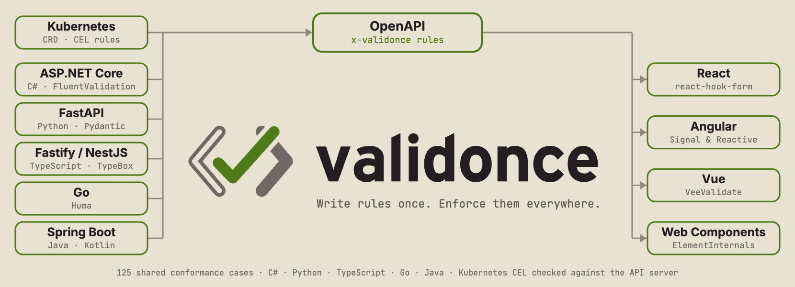

<p align="center">
  <picture>
    <source media="(prefers-color-scheme: dark)" srcset="assets/brand/banner/readme-banner-dark.png">
    
  </picture>
</p>

# validonce

Write your validation rules once, on the server, and enforce the same rules in the browser.

> **Status: v0.1.** The first release is the **regex portability linter**, a .NET tool. The rule-sharing core (ASP.NET Core, FastAPI, TypeScript and Zod) is built and tested here, and ships in v0.2.

Field rules such as types, lengths and patterns already travel from a backend's OpenAPI document to the frontend. Rules that involve more than one field do not: "company is required when the plan is Pro", "the end date must be on or after the start date". Teams end up writing those twice, once in the backend and once in the form, and the two copies drift.

validonce lets you write them once, in your server's own validation library:

- **ASP.NET Core** with FluentValidation (first)
- **FastAPI** with Pydantic

The rules are exported as data inside your OpenAPI document. A small TypeScript runtime applies them to your Zod schemas, so React and Angular forms check the same rules before anything is sent, and show the error on the right field.

## Regex portability linter (v0.1)

A `pattern` rule written on the server runs in more than one regex engine: JavaScript in the browser (through Zod), and .NET, Python `re` or Rust (Pydantic's default engine) on the server. The engines disagree more often than you would expect. `^\w+$` rejects `Café` in JavaScript and accepts it in the other three, and a lookbehind is a hard error in Pydantic.

The linter reports these differences, with a portable rewrite where one exists:

```sh
dotnet tool install -g Validonce.Cli
validonce lint-regex openapi.json            # every pattern in an OpenAPI or JSON Schema document
validonce lint-regex --pattern '^\w+$'       # a single pattern
```

It knows 25 findings across five engines (`js`, `js-u`, `python-re`, `rust-regex`, `dotnet`). Each one is backed by test cases that run on the real engines in CI, so the table cannot drift from what the engines actually do. See [spec/regex-findings.md](docs/regex-findings.md).

The tool reads an OpenAPI file, so it works for any backend language. The same checks are available as a library through the `Validonce` NuGet package (`Validonce.Patterns.PatternLinter`).

## Layout

| Path | What |
|---|---|
| `docs/` | The rule format and the regex findings table |
| `conformance/` | Shared test cases every implementation must pass |
| `dotnet/` | C#: rule types, evaluator, FluentValidation and ASP.NET Core integration |
| `js/` | TypeScript: evaluator, Zod integration, form helpers |
| `python/` | Python: evaluator and Pydantic integration |
| `examples/` | ASP.NET Core and FastAPI backends with the same rules, and a React form that reads them |
| `assets/brand/` | Logo, icons and banners (not covered by the code license) |

## Copyright and license

validonce is Copyright 2026 Metatoy LLC, licensed under the [Apache License, Version 2.0](LICENSE). See [NOTICE](NOTICE).

The validonce name and logo are not part of the code license; see [assets/brand/LICENSE](assets/brand/LICENSE).
