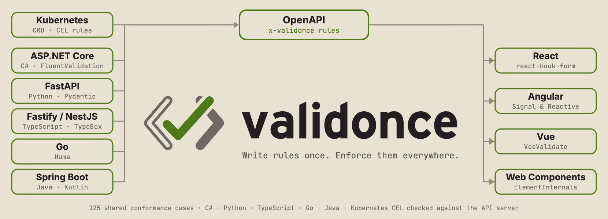

<p align="center">
  
</p>

# validonce (TypeScript)

Validate once, enforce everywhere. A server exports its cross-field rules as data; this package evaluates them in the browser and attaches them to a Zod 4 schema.

```sh
pnpm add validonce zod      # or: npm install validonce zod
```

`validonce` (the root entry) has no dependencies and no Zod. `validonce/zod` needs `zod@^4`. `validonce/openapi` has no dependencies.

## Read the rules from the OpenAPI document

```ts
import { rulesFromOpenApi } from "validonce/openapi";

const doc = await (await fetch("/openapi.json")).json();
const rules = rulesFromOpenApi(doc, "Signup"); // RuleSet | undefined
```

`allRulesFromOpenApi(doc)` returns every schema's rules by name. A malformed `x-validonce` throws `ValidonceFormatError`.

## Attach them to a Zod schema

```ts
import { z } from "zod";
import { withRules } from "validonce/zod";

const Signup = withRules(
  z.object({
    plan: z.string(),
    company: z.string().nullable().optional(),
  }),
  rules,
  { messages: { "rules.company_required": "Company is required." } },
);
```

- Client rules only: `server_only` rules are skipped.
- The rules run even when another field fails its type check. They evaluate the raw input.
- Each issue has `code: "custom"`, `path`, `message` (catalog entry with `{param}` filled in, else the key) and `params: { validonce: true, ruleId, key, params }`.
- A rule naming a field the schema lacks throws when you call `withRules`.

## Messages

```ts
import { formatMessage, defaultMessages, type Catalog } from "validonce/messages";

const catalog: Catalog = { "rules.company_required": "Company is required (min {min})." };
formatMessage(issue, catalog, rules); // catalog text, else the kind's default, else the key
```

`formatMessage(issue, catalog?, rules?)` uses the catalog entry for `issue.key` with `{param}` filled in (a placeholder with no param stays as written). With no entry, `rules` (an array, a RuleSet, or a `ruleId -> kind` map) tells it the rule's kind and it returns that kind's text from `defaultMessages` ("This field is required.", "Fill in at least one of these fields.", and so on). With neither, it returns the key. `withRules` and `fieldErrorsFromIssues(issues, catalog, rules)` both call it, so the same issue gives the same text everywhere.

## react-hook-form

```ts
import { zodResolver } from "@hookform/resolvers/zod";
import { useForm } from "react-hook-form";

const form = useForm({ resolver: zodResolver(Signup) });
// form.formState.errors.company?.message
```

### Re-check dependent fields

react-hook-form validates a field when it changes, so a `required_when` error on `company` goes stale when only `plan` changes. `validonce/react-hook-form` lists what to re-check:

```ts
import { dependentFields, registerDeps } from "validonce/react-hook-form";

dependentFields(rules); // { plan: ["company"], start: ["end"], ... }

const deps = registerDeps(rules);
<input {...register("plan", { ...deps("plan") })} /> // deps: ["company"]
```

For each field it lists the other fields where rules that read it report their error. Group rules (`at_least_one_of` and the like) report on their first field, so every other member re-checks that one. Rules marked `server_only` are skipped.

## Angular

### Signal Forms (no adapter)

The Zod schema implements Standard Schema, so Angular's `validateStandardSchema` takes it directly. Errors recompute when any field changes, so a `required_when` error on `company` clears when only `plan` changes:

```ts
import { form, validateStandardSchema } from "@angular/forms/signals";
import { withRules } from "validonce/zod";

const f = form(model, (path) => validateStandardSchema(path, withRules(Signup, rules, { messages })));
// f.company().errors() -> [{ kind: "standardSchema", message: "Company is required", ... }]
```

### Reactive Forms

```ts
import { validonceGroupValidator } from "validonce/angular";

const group = new FormGroup(
  { plan: new FormControl(""), company: new FormControl("") },
  { validators: validonceGroupValidator(rules, { messages }) },
);
// group.controls.company.errors -> { validonce: { ruleId, key, params, message } }
// group.errors                  -> { validonce: Issue[] }
```

- The validator runs against `group.getRawValue()`. Dates must be ISO strings (`YYYY-MM-DD`), which `<input type="date">` gives; an empty input (`""`) is blank.
- Each issue is set on the control at its path; other errors on that control stay, and only the `validonce` error is removed when the issue no longer applies. One control with several issues shows the first. Paths with no control are ignored (the issue still appears in `group.errors`).
- For a nested `FormGroup`, give that group its own validator with that object's rules.
- Use one validator instance per group. `server_only` rules are skipped.
- `messages` is a key -> text catalog with `{param}` placeholders; a missing key falls back to the key.

## Server errors

```ts
import { fieldErrorsFromIssues, issuesFromResponse } from "validonce/server-errors";

const issues = issuesFromResponse(await res.json()); // FastAPI 422 or ASP.NET Core ProblemDetails
const errors = fieldErrorsFromIssues(issues, messages, rules); // { "company": "Company is required." }
```

`issuesFromFastApi` and `issuesFromProblemDetails` read one shape each. Entries that are not validonce issues are ignored.

## Extract rules at build time: `validonce extract`

```sh
npx validonce extract openapi.json -o src/rules.gen.ts
npx validonce extract openapi.json --schema Signup --format json
```

Writes every schema's `x-validonce` (or only the `--schema` names; `Name-Input` is used for `Name`) as a TypeScript module, `export const rules = { Signup: { version: 1, rules: [...] } } as const satisfies Record<string, RuleSet>`, or as plain JSON. Output goes to standard output without `-o`. It is deterministic: names and keys are sorted. Exit codes: 0 done, 1 no `x-validonce` found, 2 usage error or unreadable input.

The npm `validonce` command is this TypeScript tool. The .NET and Python `validonce` commands are separate tools with their own options.

## Evaluate without Zod

```ts
import { evaluate, parseRuleSet } from "validonce";

const issues = evaluate(parseRuleSet(raw).rules, data, { side: "client" });
// [{ path, ruleId, key, params }]
```

## More

Guides for [React](https://github.com/metatoy/validonce/blob/main/docs/client-react.md) and [Angular](https://github.com/metatoy/validonce/blob/main/docs/client-angular.md), the [rule format](https://github.com/metatoy/validonce/blob/main/docs/rule-format-v1.md), and the C# and Python server packages: [github.com/metatoy/validonce](https://github.com/metatoy/validonce).

Copyright 2026 Metatoy LLC. Licensed under the Apache License, Version 2.0.
